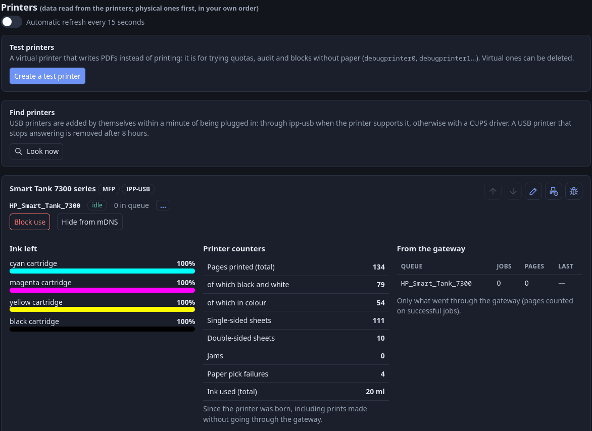

# Printers: overview, controls, maintenance print

[Documentation index](../README.md) · English · [Italiano](../it/stampanti.md)

The **Printers** page (`/admin/printers`, administrators) shows what each printer says about itself next to what the gateway recorded. Everything is read live and best effort: a printer that does not offer a source just lacks that section.

## 1. What a printer card shows

- State and queue of every CUPS queue; a device that does not answer is **NOT REACHABLE** (and disappears from the print form and from the mDNS announcement). Detection can lag ~30 s; for network queues it is a TCP probe (it can not know that paper ran out); `usb:` / `file:` queues are assumed present.
- Beside "n in queue", the **…** button shows the queue address (`ipps://<server>/printers/<name>`) with a copy button: the one to type when adding the printer by hand.
- **Ink** levels and colours (from CUPS).
- **Printer counters** (lifetime: total pages, black and white, colour, sheets, jams, pick failures) from HP's embedded web service; other brands show only IPP data.
- Serial number, firmware, speed, paper ready, alerts. A paper jam, no paper or ink/toner out or low also raise a notice ([admin-guide.md](admin-guide.md#8-notices-the-bell)).
- State and capabilities of the **scanner** (eSCL), with an *MFP* badge.
- What the gateway recorded: jobs, pages, scans, last job.

Reads are parallel, fault tolerant and cached for `SPOOLSTEWARD_PRINTERS_REFRESH_SECONDS`. The **Automatic refresh** switch under the title reloads the page by itself at that interval (off at the start, remembered by the browser, paused while a popup is open or something is being typed).
Nothing is tied to a printer model; texts from the device (ink names, firmware, warnings) are shown as received.

## 2. New and unplugged USB printers

**New printers appear by themselves.** Every `SPOOLSTEWARD_DISCOVERY_INTERVAL` seconds the gateway looks at the USB side and creates the CUPS queue of each new device, within about a minute of plugging it in. Two ways, in this order:

1. **ipp-usb** (preferred): a printer with IPP-over-USB (most recent ones) is served by the `ipp-usb` container on a port of `SPOOLSTEWARD_USB_BRIDGE_PORTS`; its queue points at `ipp://ipp-usb:<port>/ipp/print` and needs no driver.
2. **CUPS' own usb backend**: for printers without IPP-over-USB (many older lasers, for example Brother DCP-7055): the queue points at `usb://Maker/Model?serial=…` and CUPS needs a driver. The image ships brlaser, gutenprint, splix and foo2zjs; if CUPS has none
   for the model, the page says "found, but CUPS has no driver for it". A device that ipp-usb serves is never taken this way, and only after it has stayed unserved for two passes in a row (ipp-usb restarts for a few seconds whenever a USB device is plugged or unplugged).

   *Checked with a Brother DCP-7055 by USB:* detected as a USB printer, queue created with brlaser (`drv:///brlaser.drv/br7055.ppd`), first print from the portal worked with no setting changed, *landscape* too ([printing.md](printing.md)).

The queue is named after the model, shortened (at most 24 characters): noise such as "series", "printer", "MFP" and a bracketed part number is dropped, "Hewlett-Packard" becomes "HP" (`HP Smart Tank 7300 series [A7E76E]` becomes `HP_Smart_Tank_7300`, `Brother DCP-7055` becomes `Brother_DCP-7055`).
The model is what the printer declares. Each USB printer shows a badge: **IPP-USB** or **USB** (driven by CUPS directly). The **Look now** button runs a pass at once. `SPOOLSTEWARD_AUTO_DISCOVER=false` turns it all off; `SPOOLSTEWARD_USB_DIRECT=false` skips way 2.

**Unplugged printers.** A queue outlives the cable, so the card shows **NOT REACHABLE** and:

- a **Delete queue** button (any printer that does not answer, USB or network; it asks for confirmation). Block, maintenance-print settings and list position of the queue are forgotten;
- for **USB queues**, a **countdown** ("will be removed automatically in 7:41:23 unless the printer comes back"). At zero the gateway deletes the queue and writes `printer.auto_remove` in the administrators' audit (actor `system`; new devices are `printer.auto_add`). The wait is
  `SPOOLSTEWARD_OFFLINE_REMOVE_HOURS` (8; `0` = never);
- **network queues are never removed by themselves**: a printer switched off for the weekend must come back as it was.

A printer plugged in again later is simply added as new.

## 3. Order of the list

In **Printers**, in the print form of `/me/print` and wherever queues are listed: **physical printers first, oldest connection on top**; **virtual / test printers** (CUPS-PDF, `debugprinter0`…) at the bottom, also oldest first.

**Moving printers.** Each card has an up and a down arrow: they move the printer one place in **your own** list (every administrator has their own order, which is also the order of their print form). A printer moves only inside its group. Once you have moved a printer its place is
fixed; one connected later goes after those you placed. Moves are logged (`printer.move`).

**Renaming a queue.** The pencil button opens a dialog with an empty field for the new name (the last part of the address `…/printers/<name>`: letters, digits and `. _ @ + -`). CUPS can not rename a queue, so the gateway creates the new one on the same device (same driver, description and location) and only then
removes the old one; if anything fails the old queue stays. Block, hide-from-mDNS, maintenance-print settings, the countdown, the places in the lists, the printers allowed to groups and users ([quotas.md](quotas.md#5-advanced-permissions)), granted permissions and waiting requests follow the new name;
the audit keeps the old name for what already happened. A confirmation window warns that **computers and phones set up by hand with the old address will stop printing** until set up again, and has a tick, on by default, to **tell all users in their notices** (except the one who renamed). A queue with jobs waiting, a name already
in use, or a queue whose driver the gateway can not know (for example `socket://`) is refused. Options set by hand in CUPS are not carried over. Logged as `printer.rename`.

**Names used before.** The gateway remembers the names of queues that were deleted, removed automatically or renamed. In the rename dialog:

- **while you type**, if a past name starts with the letters typed, the rest shows in grey in the field, as a reminder only;
- **under the field** a line says "Used before: no queue has had this name since …", "A queue with this name already exists" (*Rename* disabled), "That is already its name" (disabled) or a warning for characters that are not allowed;
- **Names used before (n)** lists them, most recent first (at most 20, existing queues left out) with the day and how it went; clicking a name writes it in the field.

A name stops being "used before" when a queue takes it again. The use: a printer breaks, its queue is removed, a replacement arrives with another name; rename the replacement to the **old name** and computers and phones set up by hand print again with the same keys, and the permissions that listed that name apply again.
A computer set up with a driver specific to the old model may need setting up again if the new model differs; driverless (IPP Everywhere) ones do not.

CUPS does not say when a queue was created, so the gateway notes the **first time it sees** each queue (every minute). A deleted queue loses its place. The mDNS announcement stays alphabetical.

## 4. Periodic maintenance print (physical printers only)

The gateway can print a small maintenance page at regular intervals so that an idle printer does not dry its ink. Button with a printer-and-timer icon at the top right of each card (absent for virtual printers).

- **One setting per printer, the same for every administrator.** The popup has an **activation switch** (acts at once), the **interval** (1 hour to 90 days; suggested 1 week), **colour print** (if the printer has colour) and **Save**, which stores the parameters without switching the schedule on or off.
- The count starts at activation, then from the last **successful** maintenance page; user prints do not reset it.
- If the printer does not answer it retries when reachable again; if CUPS refuses the job it retries after an hour and the error stays on the card. If the gateway was off, the page is printed when it restarts (the missed interval is not made up).
- The page goes to CUPS as `gw:maintenance`: it **uses no quota**, is **not in the print audit** and **ignores the printer block and maintenance mode**. Switching on, off or saving is in the administrators' audit (`printer.keepalive_on/off/save`).

## 5. Test print with statistics

Button with a bug icon: confirmation with **Cancel**, **Print black & white**, **Print colour** (disabled without colour); prints the same statistics as the card. Logged as `printer.test_print`. A4. Pages the gateway prints itself are always in English ([languages.md](languages.md)).

## 6. Block, hide, maintenance

- **Block a printer** — takes no job from anybody, **administrators included**. Per queue.
- **Hide from mDNS** — no longer announced on the network; still usable by address.
- **Gateway maintenance** (red traffic-cone button at the top) — stops printing **and scanning** for everybody except administrators and withdraws every mDNS announcement. A red banner shows it on every page. The confirmation window has a tick, on by default, to **tell all users in their notices** that printing is suspended, or works again.

The mDNS announcer asks the gateway (`/mdns/policy`, authenticated by a code derived from `SPOOLSTEWARD_SECRET_KEY`). **Without that key the gateway refuses to answer and nothing is announced**: the answer lists the printers an administrator hid. `docker compose logs mdns` then says *"mDNS is OFF"*;
set the key in `.env` ([troubleshooting.md](troubleshooting.md#no-secret-key-is-set)). If the log says the gateway did not accept the announcer, the two containers read different keys: `docker compose up -d --force-recreate gateway mdns`.

## 7. Test printers

In **Printers** an administrator can create and delete **test printers** (`debugprinter0`, `1`, …): CUPS-PDF queues that write PDFs and use no paper. They behave like a printer for quotas and audit, are listed last and have no maintenance or test-print buttons.
`CUPS_VIRTUAL_QUEUE=1` creates a queue named `virtual` for the same purpose.
