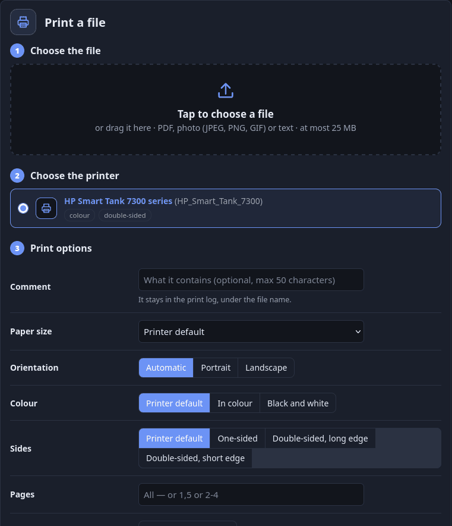
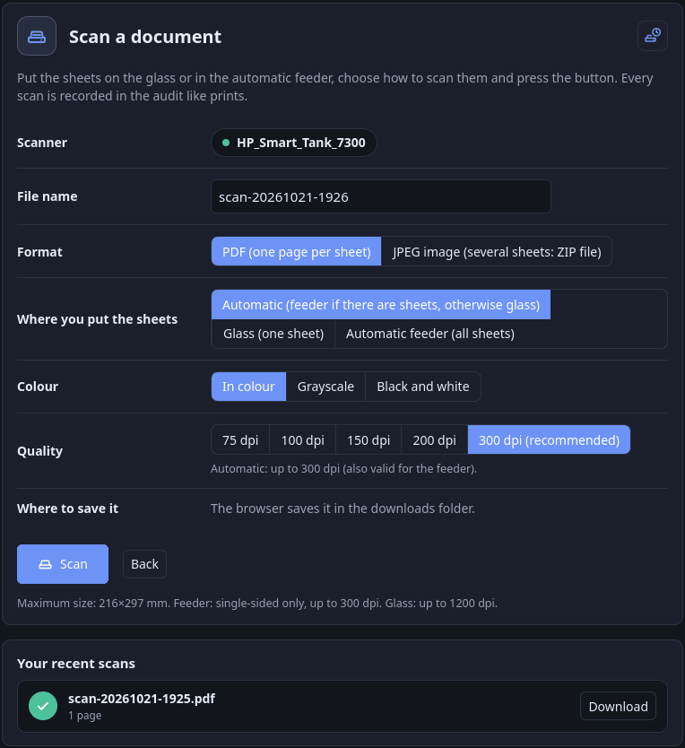

# User guide

[Documentation index](../README.md) · English · [Italiano](../it/guida-utente.md)

For people who print and scan. Everything is at `https://<server>:8631/me` (administrators arrive at `/admin`; the menu links to both).

## 1. Sign in

Sign in with the account the administrator gave you (a local password), or with your office credentials if the installation uses RADIUS. A temporary password must be changed at the first login.

## 2. My profile (`/me`)

- **Consumption**: jobs and pages used in the current week or month, your limit (extra quota included) and when it resets.
- **Documentation**: the **?** icon in the top bar opens this guide and the step-by-step guide for [Windows](windows.md).
- **Print keys**: create a key for each device (give it a label). It is shown **once**: copy it at once. Use it as the password when the computer or phone asks for credentials; the user name is yours. A key only prints and scans — it never opens the portal and your domain
  password is never needed on a device. Revoke a key (or all) in *My keys* if a device is lost. You choose how long it lasts (1 month to 2 years, or one print only); RADIUS users have a shorter maximum and renew by signing in again. The bell tells you when an administrator revokes, switches off or extends one.
- **Requests**: ask for more quota (temporary or permanent), a change of group or a permission, and say why (optional unless required). The administrator approves, edits or rejects. Up to 3 open requests by default; you can cancel them.
- **Your permissions**: whether you may print in colour and one-sided, on which printers, at which hours. Without colour your prints come out in black and white; without one-sided, double-sided. Scanning is not affected. Next to what you lack there is an **Ask** link (and **Ask for another printer**):
  choose what you need, write why, and an administrator answers, permanently or until a date. While a request waits you see "(request waiting)". The bell tells you when it is approved, rejected or ended.

If a print is refused for quota, the message includes the link to ask for an exception. If it is refused because of your permissions (a printer you may not use, a time outside your hours, or colour / one-sided when the installation refuses instead of correcting), the message points to this page, and the bell tells you what to change.
A print made in black and white or double-sided because of your permissions gets a notice too.

**Every refused or changed print gets its notice.** While one of the same kind is still open it is renewed instead of repeated: its time is updated, it shows how many times it happened (×3) and the bell lights up again, so a program that retries does not fill the list.

**Secondary notices.** The prints **forced** by your permissions (black and white, double-sided) are only information: they are marked as read by themselves after a while (*Settings* → "Secondary notices": 20 minutes by default, counted from the last such print; 0 = they stay until you dismiss them). They are not deleted: see *Show dismissed too*.
All other notices (refused prints, quota reached, keys, group, requests) stay until you dismiss them.

## 3. Print (`/me/print`)

Upload a PDF, photo (JPEG, PNG, GIF) or plain text. Choose the printer (only those you may use), paper size, orientation, colour or black and white (only if you may print in colour), one-sided or double-sided (only if you may print one-sided and the printer has a duplex unit), a page range (`1,5` or `2-4`), copies and an optional comment
(50 characters, visible to administrators next to the file name). Same quota and audit as every other print; works from a phone with nothing installed. To connect a computer: [printing.md](printing.md).

## 4. Scan (`/me/scan`)

Choose the scanner, the source (automatic, glass, or feeder for all sheets), colour mode, quality, paper size, format (PDF or JPEG) and a file name. You can leave the page while it scans and come back to download the file soon: it is kept 10 minutes unless the administrator changed it, and sooner if the server's scan memory is full. See [scanning.md](scanning.md).

When the scan is finished the file appears under *Your recent scans*, with its *Download* button:

### Scanning from an app that cannot sign in

Most scan programs (NAPS2 and many others) cannot send a user name and password, so the gateway refuses them. If the button with a scanner and a clock is at the top right of *Scan*, you can let your program in for a few minutes:

1. On the **computer where the scan program runs**, open *Scan* and press the button.
2. A box shows the address the server sees you at and a countdown (3 minutes unless the administrator changed it).
3. Start the scan in your program. Scans from that address are accepted as yours: your quota and permissions apply and they appear in the audit under your name. You can scan as often as you like until the time ends; a scan already started is delivered even if the time runs out. *Close the window* ends it earlier.

A scan from a different address is refused, the audit records both addresses and your bell says so. Limits, because the gateway can only compare addresses:

- **NAT**: behind a router shared with other devices (another network, VPN, guest Wi-Fi) the server may see the same address for every device, so during the window those devices can scan too.
- **IPv4 and IPv6**: if the portal is reached over IPv6 and the scan app uses IPv4 (or the reverse), the addresses never match. Open the portal with the same kind of address the scan app uses.
- **Reverse proxy**: if you opened the portal through a proxy, the scan app will be refused (or, if it goes through the proxy too, any device behind it could scan). Open the portal directly on the server's port (`https://<server>:8631`) before pressing the button; the box warns you when it detects a proxy.

## 5. Settings (`/me/settings`: click the logo and name at the top left)

- **Theme**: light, dark or automatic. **Language**: English, Italiano, Español, Русский, 中文 (saved for your account).
- **Auto-refresh** interval of the audit page (administrators); **Secondary notices** delay (see above); **Change password** (local accounts).

## 6. Good to know

- Your quota counts accepted, completed and held jobs; refused, failed and canceled-before-printing jobs are free. A pages limit is checked before printing: a document that does not fit is refused at once.
- Printers that do not answer, are blocked, or you may not use are not offered.
- If your hours are limited and it is outside them, the print page says when you can print, and a job sent anyway is refused.
