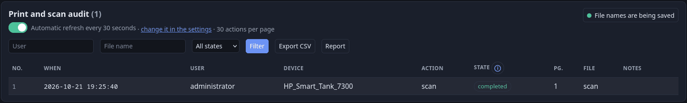

# Audit

[Indice della documentazione](../README.md) · [English](../en/audit.md) · Italiano

SpoolSteward tiene **due registri in cui si aggiunge soltanto**:

| Registro | Tabella | Contenuto | Pagina |
|---|---|---|---|
| Audit di stampe e scansioni | `job_log` | chi ha stampato o scansionato cosa | **Audit** (`/admin/jobs`) |
| Azioni amministrative | `admin_audit` | chi ha fatto cosa nel portale | **Azioni admin** (`/admin/actions`) |

Gli id non si riusano mai. **Nessuna funzione del portale cancella righe.** L'audit si conserva per sempre.

## 1. Audit di stampe e scansioni

Ogni riga ha: numero progressivo, ora, utente, dispositivo (coda di stampa o scanner), nome file, tipo (stampa / scansione), esito, pagine, motivo del rifiuto e opzioni (carta, colore, fronte-retro, sorgente, copie, intervallo di pagine, commento, `via` web / IPP…).

**Il nome del file** si può smettere di salvare con il pulsante verde/rosso in alto a destra della pagina; con la retention (`.env`) sparisce dopo un numero di giorni a scelta. La riga resta sempre. Dettagli: [protezione-dati.md](protezione-dati.md).

| Stato | Significato |
|---|---|
| `accepted` | Ha superato i controlli ed è stato consegnato a CUPS o allo scanner. **Conta già per la quota.** |
| `completed` | Concluso; le pagine sono quelle **reali** lette da CUPS |
| `held` | Trattenuto in coda; conta per la quota |
| `denied` | Rifiutato (quota, permesso, blocco, manutenzione, account disattivato). Non conta e non usa pagine. Il motivo è conservato (in inglese) |
| `failed` | Accettato ma la stampante o lo scanner non ha potuto eseguirlo. Non conta |
| `canceled` | Fermato prima di stampare, dall'utente, da un amministratore o dal programma di scansione. La quota si libera |

Ha un interruttore **Aggiornamento automatico** (intervallo nelle *Impostazioni*, predefinito 30 s; con 0 l'interruttore parte spento e usa 30 s quando lo accendi; la scelta la ricorda il browser). I testi lunghi sono accorciati con «…» e si leggono per intero in un popup. Sono disponibili filtri ed **esportazione CSV**. *Annulla* ferma un job in coda (con l'identità del proprietario).

Le scansioni senza credenziali (eSCL anonimo) mostrano IP e nome host di chi chiama nella colonna delle informazioni. Una scansione fatta con una finestra di scansione mostra l'indirizzo da cui è arrivata; una richiesta rifiutata perché arrivava da un indirizzo diverso da quello della finestra è una riga *negata* a nome del proprietario, e l'icona mostra i due indirizzi.

### Report di utilizzo

*Report* (pulsante accanto a *Esporta CSV*, pagina `/admin/report`) ordina gli utenti per pagine stampate in un periodo. Scegli il periodo con un pulsante (*Oggi*, *Ultimi 7 giorni*, *Questo mese*, *Mese scorso*, *Ultimi 30 giorni*, *Quest'anno*) oppure scrivendo le due date come `2026-10-31`, quanti utenti elencare, i gruppi da **escludere** e **Report dettagliato**, che aggiunge per ogni
utente le stampe per stampante. Lo vedi nella pagina o lo scarichi in **CSV** o **PDF**. Contano solo le stampe (completate, in attesa o in corso). Le righe già spostate in un archivio compresso non vengono lette: la pagina avvisa quando il periodo arriva fin lì. Il PDF è in inglese con i font standard, quindi i nomi con lettere cirilliche o cinesi vi compaiono come `?`; il CSV li conserva.

## 2. Allineamento con CUPS

Ogni 30 s il **riconciliatore** legge CUPS: un job finito diventa `completed` con le sue pagine reali; uno annullato prima di stampare restituisce la quota; le riserve senza job CUPS da oltre 1 ora (gateway morto a metà) vengono liberate; un job scomparso dallo storico da oltre un giorno è segnato come completato.

## 3. Audit amministrativo

Registrati: `login` (amministratori), `admin.setup` / `admin.set_password`, `user.*` e `group.*`, `password.change`, `key.*` (crea, revoca, disattiva, riattiva, prolunga), `request.approve/reject`, `grant.create/revoke/purge`, controlli delle stampanti (`printer.block/unblock`, `mdns_hide/mdns_show`, `keepalive_on/off/save`, `test_print`,
`debug_create`, `delete`, `move`, `rename`, `forget_name`, e dal sistema `auto_add` / `auto_remove`), `job.cancel` / `job.cancel_failed`, `jobtitles.on/off`, `backup.*`, `maintenance.on/off`, `audit.archive`, `archive.verify`, `notice.dismiss` / `notice.dismiss_all`, `update.request`.
Ogni voce conserva il *nome* di chi ha agito (sopravvive all'eliminazione di quell'utente), l'azione, il bersaglio e i dettagli. La pagina ha filtri con suggerimenti.

## 4. Archivio

Quando le tabelle attive superano `SPOOLSTEWARD_AUDIT_MAX_MB` (predefinito 50), l'archiviatore (ogni `SPOOLSTEWARD_AUDIT_CHECK_INTERVAL`) sposta le **righe più vecchie** in `data/audit-archive/audit-<tabella>-<da>-<a>.jsonl.gz`. Garanzie:

1. Le righe delle finestre di quota ancora in corso (mese precedente e corrente, più un margine) **non** vengono mai archiviate, quindi i limiti non cambiano.
2. Il file si scrive come `.pending`, si scarica su disco, si **rilegge e si verifica** (sha256).
3. Solo allora, in **una sola transazione**, l'archivio è registrato in `audit_archive` (percorso, intervallo di date e id, righe, dimensione, sha256) e le righe sono tolte.
4. Il file viene rinominato e reso in sola lettura; un archivio esistente non viene mai sovrascritto.
5. Un'interruzione in qualunque punto non perde né duplica nulla: i file `.pending` vengono riparati o ripuliti al riavvio.

La pagina **Archivio audit** (`/admin/archive`) elenca gli archivi con il percorso nel contenitore e sul server (`AUDIT_ARCHIVE_HOST_PATH`), dimensione e sha256; li apre con ricerca e paginazione, li **scarica** e ne **verifica l'integrità**. Non può eliminarli. `spoolsteward-admin audit-archive [--force]` lancia l'archiviatore a mano; `spoolsteward-admin jobs` mostra le ultime righe.

I nomi dei file nell'archivio sono cifrati solo se hai acceso la cifratura dei nomi ([protezione-dati.md](protezione-dati.md)); il portale li decifra quando li mostra e quando cerchi. Con la retention accesa, le righe oltre il limite vengono scritte senza il nome. I file già scritti non si modificano.
La cartella deve essere scrivibile dall'utente del contenitore; sta sull'host, fuori dai volumi docker, ed è inclusa nei backup ([backup.md](backup.md)).

## 5. Privacy

Il database e gli archivi contengono i nomi dei file stampati, che sono dati personali: proteggi `data/` e il volume di conseguenza.
