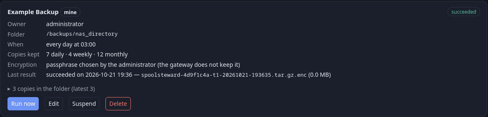

# Backup e ripristino

[Indice della documentazione](../README.md) · [English](../en/backup.md) · Italiano

Esistono due meccanismi indipendenti:

| | Backup integrati (portale) | `scripts/backup.sh` (lato host) |
|---|---|---|
| Chi | ogni amministratore, più uno *generale* | chi gestisce il server |
| Cosa | database (copia coerente mentre si stampa) e archivio audit; con la cifratura anche `.env` (tutte le impostazioni e i segreti) e il certificato TLS | database, `config/` (con i segreti), `.env`, archivio audit e code CUPS |
| Quando | programmato, una volta al giorno | a mano |
| Serve per | la protezione di ogni giorno | **spostare la macchina** |

## 1. Backup integrati (menu *Backup*)

Ogni amministratore crea i **propri** backup programmati, con cartella, ora, numero di copie da tenere (ultime N giornaliere,
settimanali, mensili) e cifratura. Modifica ed elimina solo i propri; *Esegui ora* è disponibile a tutti. Il backup *Generale*
dell'installazione si mostra in sola lettura: si imposta in `.env` (`SPOOLSTEWARD_BACKUP_*`).



- Un backup è scritto in `.partial`, **riletto e verificato**, rinominato; solo dopo si tolgono le copie vecchie. *Esegui ora* aggiunge
  una copia senza cancellarne (la pulizia la fa la prossima esecuzione programmata).
- Se un backup è fallito, o l'ultimo ha più di 48 h, la pagina lo mostra in rosso **e nella campanella compare un avviso** con il nome del backup (vedi «Avvisi» più sotto). L'avviso si chiude da solo al primo backup riuscito.
- La rotazione riguarda solo i file con il nome dello stesso gateway e della stessa destinazione.
- Ogni file è `spoolsteward-<istanza>-t<destinazione>-<ora UTC>.tar.gz` (più `.enc` se cifrato) con un `MANIFEST.json` (sha256 e dimensione
  di ogni parte, versione dell'app, revisione dello schema).
- Senza cifratura il file **non contiene segreti** (chiave TLS, `SECRET_KEY`, segreto RADIUS).

### Dove

Solo dentro `data/backups` (`BACKUP_DIR`, montata su `/backups`); un amministratore sceglie una sottocartella (lettere, cifre, spazio,
`. _ -` e `/`, al massimo 4 livelli) e non può uscirne (`..`, percorsi assoluti e link simbolici sono rifiutati). Per un NAS o un disco
USB montalo sul server **dentro quella cartella prima di avviare il gateway** (un montaggio fatto dopo richiede il riavvio del gateway, vedi sotto).

### Salvare su un disco di rete (NAS, SMB/CIFS, NFS) o su un disco USB

1. **Montalo sul server, dentro `data/backups`** (la cartella indicata da `BACKUP_DIR`). Usa `/etc/fstab` perché torni al riavvio, per esempio:

   ```
   # SMB/CIFS: uid/gid = PUID/PGID di .env, così il gateway può scrivere. La password in un file leggibile solo da root.
   //nas.lan/backups  /srv/spoolsteward/data/backups/nas  cifs  credentials=/root/.nas-cred,uid=1000,gid=1000,vers=3.0,_netdev,nofail,x-systemd.automount  0 0
   # NFS: la cartella esportata deve essere scrivibile da quell'id utente (controlla "root squash" sul NAS)
   nas.lan:/export/backups  /srv/spoolsteward/data/backups/nas  nfs  _netdev,nofail,x-systemd.automount,soft,timeo=100  0 0
   ```
2. Montalo **prima** di avviare il gateway. Un montaggio fatto dopo non è visto da un contenitore già in esecuzione: riavvialo
   (`docker compose restart gateway`).
3. Nel modulo del backup scrivi la sottocartella (`nas/...`) e lascia spuntato **«La cartella è un disco di rete o USB: scrivi solo se è montato»**
   (è spuntato di default per i backup nuovi) e salva *mentre il disco è montato*. Il gateway mette un piccolo file `.spoolsteward-destination` e da quel momento **rifiuta il backup se il
   file non c'è**. Senza questo, un disco che non si monta lascia una cartella vuota sul disco del server e i backup la riempiono in silenzio
   (e non sono affatto fuori dalla macchina). Il backup Generale (quello di `.env`) ha l'opzione spenta di default (`SPOOLSTEWARD_BACKUP_REQUIRE_MARKER=false`): la sua cartella esiste sempre dentro il
   contenitore, anche a disco non montato. Se lo fai puntare a un disco di rete, metti `true` e crea il file a mano una volta, a disco montato:
   `touch data/backups/nas/<cartella>/.spoolsteward-destination`.

Comportamento del gateway con un disco di rete:

- Disco che non risponde: la pagina *Backup* si carica in circa 6 secondi e mostra il problema; un backup fallisce dopo 20 secondi
  con «Il disco dei backup non ha risposto…». Al massimo 4 richieste aspettano insieme su un disco morto; il resto del portale non ne risente.
- Con l'opzione del marker attiva, un disco non montato non riceve mai un file; il backup fallisce con «Il file segnaposto manca…».
- Un disco montato dopo l'avvio del gateway di default non viene visto. Riavvia il gateway, oppure monta la cartella con
  `bind: {propagation: rslave}` in `docker-compose.yml` (la cartella deve stare su un mount condiviso, che è il default con systemd).
- Su SMB/CIFS e in alcune configurazioni NFS i permessi dei file li decidono le opzioni di montaggio, **non** il gateway: il solito
  `chmod 600` non ha effetto e chiunque legga la condivisione legge i file. **Usa la cifratura** per i backup su una condivisione.
- Usa montaggi `soft` (NFS: `soft,timeo=100`; CIFS: `soft`), mai `hard`, così un NAS morto non blocca il server.
- Un disco che smette di rispondere **mentre un backup viene scritto** può lasciare quel backup bloccato: i successivi dicono allora «Un altro backup è in corso» finché il gateway non viene riavviato (`docker compose restart gateway`). Quello che era già salvato non si perde.
- Il backup è «fuori dalla macchina» solo se la condivisione sta su un'altra macchina. Un disco USB attaccato al server protegge da un disco rotto, non da un incendio.

### Avvisi quando il backup non riesce

Se un backup non riesce, nella campanella degli amministratori compare un avviso con il **nome vero** del backup. Esempio, a disco non montato:

> **Backup non eseguito: la cartella di destinazione non è raggiungibile.** L'ultimo backup di «NAS ufficio» non è stato salvato, perché il disco di rete o USB non risulta collegato. Nessun file è stato scritto. Controlla che sia acceso e montato, poi premi «Esegui ora». Ultimo backup riuscito: 2026-10-12 03:00:04.

Per ogni altro errore (disco pieno, permessi, passphrase…) l'avviso dice «Backup fallito» e il motivo. Il gateway ritenta ogni ora e l'avviso si chiude da solo quando un
backup riesce. Se vuoi aspettare meno, premi *Esegui ora* dopo aver rimontato il disco.

### Cifratura

- **Passphrase** (consigliata; **non** la password dell'account: il gateway non la conosce, cambia, e per RADIUS non è dell'utente),
- **chiave di recupero** creata sul server (`spoolsteward-admin backup-key`: la passphrase non passa dal portale),
- oppure **nessuna**.

Come funziona: si crea una sola volta una coppia di chiavi. La metà pubblica cifra ogni file (X25519 effimera + HKDF + AES-256-GCM a
blocchi di 1 MiB, ultimo blocco marcato); la metà privata è conservata **avvolta** da scrypt della passphrase e copiata
nell'intestazione del file, quindi *file + passphrase* bastano. Il gateway non conserva mai la passphrase: **senza di lei le copie non
si aprono**, nemmeno da un altro amministratore. La passphrase non è mai scritta nell'audit. Un nuovo file cifrato viene riletto con la
chiave appena usata.

### Salva la chiave segreta

`SPOOLSTEWARD_SECRET_KEY` in `.env` cifra i nomi dei file conservati nell'audit ([protezione-dati.md](protezione-dati.md)). Un backup
**senza cifratura non la contiene**, apposta (non contiene segreti). Quindi se il server si rompe, ripristini un backup non cifrato
su una macchina nuova e `scripts/docker-init.sh` crea una chiave **nuova**, il database torna intero (utenti, quote, pagine, date,
stampanti) ma i nomi dei file restano `[encrypted]` per sempre.

- Copia la riga `SPOOLSTEWARD_SECRET_KEY=...` di `.env` in un password manager o in un altro posto sicuro, **una volta**, dopo l'installazione.
- Oppure fai backup cifrati: includono `.env`, quindi la chiave viaggia insieme al database.
- Quando passi a un'altra macchina, copia anche `.env` (`scripts/backup.sh` lo fa).

Il gateway aiuta: dopo il primo avvio l'amministratore del primo avvio (`SPOOLSTEWARD_BOOTSTRAP_ADMIN_USERNAME`) trova un promemoria nella
propria campanella, una volta sola (se quell'account non esiste, lo vedono tutti gli amministratori). Se poi il gateway parte con una
chiave diversa, la campanella lo dice e indica quanti nomi non si leggono più; rimettendo la vecchia chiave in `.env` e riavviando
tornano leggibili.

## 2. Ripristino

```sh
docker compose stop gateway mdns
docker compose run --rm -it --no-deps gateway spoolsteward-admin backup-restore /backups/<cartella>/<file>
docker compose up -d
```

Il ripristino legge e controlla prima tutto il file; un file danneggiato o troncato, una passphrase sbagliata, un backup senza database o fatto da una versione
più nuova vengono rifiutati e il database attuale non viene toccato. Altrimenti il vecchio database resta accanto come `spoolsteward.db.before-restore-…`; i file di configurazione finiscono in `/data/restored-config` (da
copiare in `./config` su una macchina nuova). `backup-verify <file>` controlla un file senza ripristinarlo; `backup-run [--id N]` lancia
i backup a mano. Il ripristino è la via di ritorno dopo un aggiornamento che vuoi annullare.

## 3. Backup completo dal lato host

```sh
scripts/backup.sh backup [CARTELLA]        # scrive CARTELLA/spoolsteward-v<versione>-AAAAMMGG-HHMMSS.tar.gz  (predefinito ./backups; <versione> = la versione in uso)
scripts/backup.sh restore FILE.tar.gz      # ferma prima il gateway e chiede conferma
```

Include il database (con la chiamata di backup di SQLite), `config/` (segreti compresi), `.env`, l'archivio audit e la configurazione
di CUPS (le code). Non include le immagini né lo spool dei job in corso. L'archivio contiene segreti: tienilo riservato quanto il server.
`restore` riporta il `.env` del backup, quindi anche la sua versione: se i file della cartella sono di un'altra versione, ti dice di eseguire `scripts/update.sh <versione>` (vedi "Tornare a una versione più vecchia" in [installazione.md](installazione.md)).
`scripts/backup.sh` non ha bisogno di Internet: usa l'immagine che lo stack sta già eseguendo, e il ripristino controlla tutto prima e ferma l'applicazione solo quando è sicuro di poter proseguire.
`restore` è provato solo a mano.

## 4. Limiti

Solo SQLite (con un altro database usa il suo strumento di dump); i backup integrati non includono le code CUPS (si ricreano da
`CUPS_QUEUES`, oppure si usa `scripts/backup.sh`); i file di configurazione non si ripristinano da soli (il contenitore li ha in sola
lettura); nessuna destinazione remota diretta (SSH/S3): si monta sul server; la passphrase non è recuperabile.
