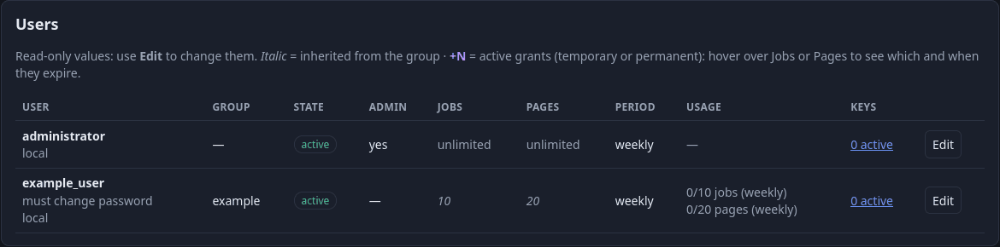
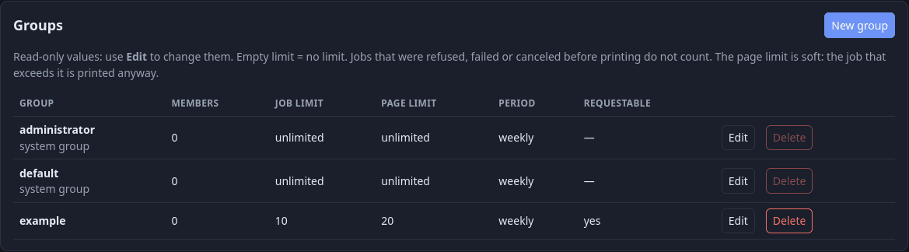

# Guida per l'amministratore

[Indice della documentazione](../README.md) · [English](../en/admin-guide.md) · Italiano

Per chi gestisce l'installazione. Il portale è su `https://<server>:8631/` (accesso su `/login`, configurazione del primo avvio su `/setup`). Il menu in alto:

| Menu | Pagina | Cosa ci fai |
|---|---|---|
| **Audit** | `/admin/jobs` | Chi ha stampato o scansionato cosa; filtri, CSV, report d'uso (`/admin/report`), annullare job in coda → [audit.md](audit.md) |
| **Utenti** | `/admin/users` | Crea utenti locali o RADIUS, modifica, reimposta la password, revoca le chiavi, elimina |
| **Gruppi** | `/admin/groups` | Crea, rinomina, limiti, "richiedibile", elimina |
| **Richieste** | `/admin/requests` | Approva, modifica o rifiuta le richieste di quota, di gruppo e di permesso (contatore = in attesa); concessioni attive, concessioni dirette, storico → [quote.md](quote.md) |
| **Azioni** | `/admin/actions` | Chi ha fatto cosa nel portale |
| **Stampanti** | `/admin/printers` | Stato, inchiostro, contatori; blocco, nascondimento, rinomina, ordine, stampanti di prova, stampa periodica e di prova → [stampanti.md](stampanti.md) |
| **Backup** | `/admin/backups` | I tuoi backup programmati → [backup.md](backup.md) |
| **Archivio** | `/admin/archive` | Audit vecchio compresso, consultabile e scaricabile |
| **Stampa / Scansiona / Profilo** | `/me…` | Le stesse pagine degli utenti → [guida-utente.md](guida-utente.md) |
| **Logo, nome e (utente)** | `/me/settings` | Tema, lingua, aggiornamento |
| **Campanella** (amministratori) | `/admin/notices` | Cose che il gateway ha notato (il numero indica quelle aperte), vedi §8 |
| **?** (tutti) | `/docs` | Questa documentazione, in italiano o inglese. Gli utenti che non sono amministratori vedono solo la guida utente e la guida Windows |
| **Manutenzione** (cono stradale rosso) | — | Ferma stampa e scansione per tutti tranne gli amministratori |
| **Porta con freccia** | — | Esci |

## 1. Primi passi

1. Imposta la password di `administrator` con il codice monouso ([installazione.md](installazione.md#36-primo-amministratore)).
2. Crea il **tuo** account amministratore (Utenti → crea → amministratore) e usa quello ogni giorno. `administrator` è l'account di emergenza: nessun gruppo, nessuna quota, nessun permesso; tienilo per il recupero.
3. Modifica i limiti del gruppo **default** (Gruppi) e crea gruppi per chi ha bisogno di limiti diversi.
4. Crea gli utenti, o lascia entrare quelli RADIUS. Di' a tutti di creare una chiave di stampa ([guida-utente.md](guida-utente.md)).
5. Imposta un backup ([backup.md](backup.md)).

## 2. Utenti

L'elenco è in sola lettura: limite proprio o ereditato (in corsivo), concessioni attive come `+N` colorato, consumo e chiavi attive. **Modifica** apre la pagina con tutti i campi e l'**origine** dell'account (locale o RADIUS, informativa); **Elimina** chiede di scrivere il nome.

- **Locale**: si mostra una password temporanea una volta; l'utente la cambia al primo accesso. **Reimposta password** ne dà una nuova. **RADIUS**: scegli il gruppo; la persona entra con la password d'ufficio.
- **Chiavi** (`/admin/users/<id>/keys`): **disattiva** (la scadenza continua a scorrere), **prolunga** (conta da oggi) o **revoca** ogni chiave; «Revoca tutte» ferma ogni dispositivo dell'utente. L'utente riceve una notifica per ogni azione (non per le sue). Le chiavi revocate e scadute spariscono dopo `SPOOLSTEWARD_KEY_HISTORY_DAYS`.
- **Flag admin**: la promozione sposta l'utente nel gruppo `administrator`, il declassamento in `default`.
- Non puoi disattivare, declassare o eliminare te stesso, l'account di emergenza o l'ultimo amministratore. Eliminare conserva lo storico ([account.md](account.md#7-eliminare-un-utente)).

## 3. Gruppi e limiti

Un gruppo ha dei limiti (job / pagine, settimanali / mensili) e un flag **richiedibile**. I gruppi di sistema `default` e `administrator` non si eliminano; eliminare un altro gruppo sposta i suoi utenti in `default`. I limiti personali sono nella pagina di modifica dell'utente. Dettagli: [quote.md](quote.md).

I **Permessi avanzati** (colore, solo fronte, stampanti, giorni e orari) sono in fondo alla pagina del gruppo e dell'utente. `SPOOLSTEWARD_PERMISSION_MODE` decide se un client che chiede in modo esplicito qualcosa di non consentito viene corretto (`adjust`, predefinito) o rifiutato (`refuse`): leggi prima
[quote.md](quote.md#5-permessi-avanzati). All'utente arriva un avviso quando cambi i suoi permessi propri e quando un suo lavoro viene rifiutato o corretto.

## 4. Richieste e concessioni

Una sola pagina, *Richieste*, in tre parti:

- **Richieste in attesa**: modifica quantità o tipo prima di approvare, aggiungi una sola nota (l'utente la vede). Una richiesta di permesso si approva *permanente* oppure *fino alla fine del* giorno scelto. Due approvazioni simultanee concedono una volta sola.
- **Concessioni attive**: quota extra e permessi che contano adesso; li revochi, o ne dai uno direttamente con una nota (scegli *quota* o *un permesso*).
- **Storico** (chiuso finché non lo apri): ultime decisioni e concessioni che non contano più. *Elimina le concessioni scadute* toglie quelle (di entrambi i tipi); il registro degli amministratori conserva chi ha concesso cosa.

Altri dettagli in [quote.md](quote.md#chiedere-un-permesso). Tutto viene registrato.

## 5. Stampanti, audit e archivio

Blocca o nascondi una stampante, crea stampanti di prova, imposta la stampa di manutenzione, invia una stampa di prova, attiva la **manutenzione del gateway**: [stampanti.md](stampanti.md). Per l'audit, i filtri, il CSV, annullare job in coda e leggere i file archiviati: [audit.md](audit.md). Nulla lì si può cancellare.

## 6. Riga di comando (`spoolsteward-admin`)

Dentro il contenitore: `docker compose exec gateway spoolsteward-admin <comando>` (aggiungi `-it` quando chiede una password).

| Comando | Scopo |
|---|---|
| `set-admin-password [utente]` | crea o aggiorna un amministratore **locale** (predefinito `administrator`) e ne imposta la password |
| `make-admin <utente>` | concede i diritti di amministratore (crea l'utente se serve) |
| `set-group <utente> <gruppo>` | sposta un utente in un gruppo (lo crea) |
| `group-limit <gruppo> <limite\|none> [--period weekly\|monthly] [--metric jobs\|pages]` | imposta un limite di gruppo; `none` lo toglie |
| `user-limit <utente> <limite\|none> [--period …] [--metric …]` | imposta un limite personale |
| `jobs [-n N]` | mostra le ultime righe dell'audit (e avvisa se esistono archivi) |
| `audit-archive [--force]` | archivia subito le righe vecchie dell'audit |
| `backup-key` | crea una chiave di recupero dei backup da una passphrase |
| `backup-run [--id N]` | esegue subito i backup abilitati |
| `backup-verify <file>` | controlla un file di backup |
| `backup-restore <file>` | ripristina database e file dell'audit (ferma prima il gateway) |

## 7. Operatività

- Salute: `GET /healthz` → 200 o 503, corpo `{"status":"ok"}`, senza login. `SPOOLSTEWARD_HEALTHZ_INFO=version,printers` aggiunge altro. Log: `docker compose logs gateway`.
- Le migrazioni partono da sole all'avvio. Fai un backup prima di aggiornare un database importante.
- Nomi dei file nell'audit: il pulsante verde/rosso in alto a destra in *Audit* smette di salvarli; `.env` può cancellarli dopo qualche giorno o cifrarli ([protezione-dati.md](protezione-dati.md)).
- Aggiornamenti: in cima compare un avviso quando esiste una release più nuova. Aggiorna con `scripts/update.sh`, oppure con il pulsante *Aggiorna* in *Backup* quando gira il contenitore facoltativo updater e c'è un backup programmato funzionante ([installazione.md](installazione.md#5-aggiornamenti)). L'updater controlla Docker, cioè tutto il server: tienilo spento se non ti serve.
- Non lasciare account o stampanti di prova su un'installazione vera. Proteggi `config/`, `.env`, `data/` e il volume: contengono segreti e dati personali.

## 8. Avvisi (la campanella)

La campanella elenca ciò che il gateway ha notato e nessuno ha chiesto, con l'ultima volta, la fonte e quante volte è successo; *Chiudi* lo chiude (registrato in *Azioni*).

| Avviso | Significato | Si chiude da solo quando |
|---|---|---|
| Una richiesta di scansione senza nome utente e password da IP è stata rifiutata | `SPOOLSTEWARD_ESCL_ANONYMOUS` è spento e un client non ha inviato credenziali ([scansione.md](scansione.md)) | mai (chiudilo tu) |
| **Backup non eseguito: la cartella di destinazione non è raggiungibile** | Manca il file marcatore (disco non montato); non è stato scritto nulla ([backup.md](backup.md)) | il backup successivo riesce |
| **Backup fallito** | Qualunque altro errore, con il motivo; entrambi riportano il nome vero del backup | il backup successivo riesce |
| **Il certificato TLS è scaduto**, **non è stato possibile aggiornarlo**, **l'indirizzo annunciato non è nel certificato**, **scade il (data)** | [certificati.md](certificati.md) | la causa sparisce |
| **Inceppamento carta** / **Carta finita** | Una stampante fisica lo segnala (controllo ogni minuto, segnalato dopo due controlli) | la stampante smette di segnalarlo |
| **Inchiostro o toner esaurito** / **in esaurimento** | Esaurito: livello 0 o lo dice la stampante. In esaurimento: la soglia «basso» della stampante. Entrambi indicano i materiali | la stampante smette di segnalarlo |
| **Salva la chiave segreta in un posto sicuro** | Una volta, all'amministratore del primo avvio (o a tutti gli amministratori se quell'account non esiste); si ripete una volta se la chiave cambia ([backup.md](backup.md#salva-la-chiave-segreta)) | mai (chiudilo tu) |
| **La chiave segreta è cambiata** | La chiave è diversa da quella dell'avvio precedente; dice quanti nomi di file cifrati non si leggono più | mai (chiudilo tu) |
| **Nessuna chiave segreta impostata** | `SPOOLSTEWARD_SECRET_KEY` è `none` o manca: le sessioni finiscono a ogni riavvio e le stampanti non vengono annunciate (mDNS) | la chiave viene impostata |

**Problemi di stampante e utenti.** Gli avvisi sulle stampanti sono sempre per gli amministratori. Con `SPOOLSTEWARD_PRINTER_ALERTS_USERS=true` (predefinito) chi ha una stampa in attesa su quella stampante riceve un avviso anche nella propria campanella (inceppamento, carta e inchiostro finiti; non «in esaurimento»), e solo lui. Si chiude quando la stampante torna a posto.

**Una sola campanella.** Un amministratore ha una sola campanella: `/admin/notices` mostra prima gli avvisi sul proprio account («Per te»: chiavi, gruppo, quota, richieste) e poi quelli del gateway; il numero rosso somma entrambi. `/me/notices` manda gli amministratori lì.

Perché un client che riprova 100 volte non riempia l'elenco, lo stesso avviso dalla stessa fonte viene scritto di nuovo solo dopo un intervallo e le ripetizioni sono contate; lo stesso testo va nel log del container con lo stesso limite. L'intervallo dipende da `SPOOLSTEWARD_LOG_LEVEL`
(`DEBUG` 1 minuto, `INFO` 1 giorno, `WARNING` 3 giorni, `ERROR` 7 giorni) o si imposta con `SPOOLSTEWARD_NOTICE_INTERVAL`. Si tengono al massimo 200 avvisi aperti per tipo; quelli chiusi vengono rimossi dopo 90 giorni.
