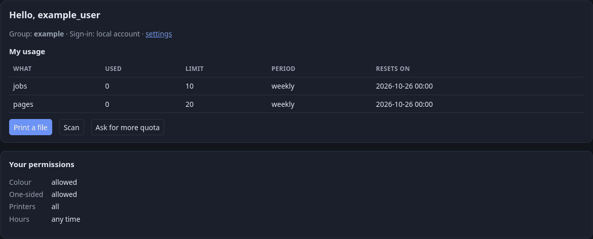
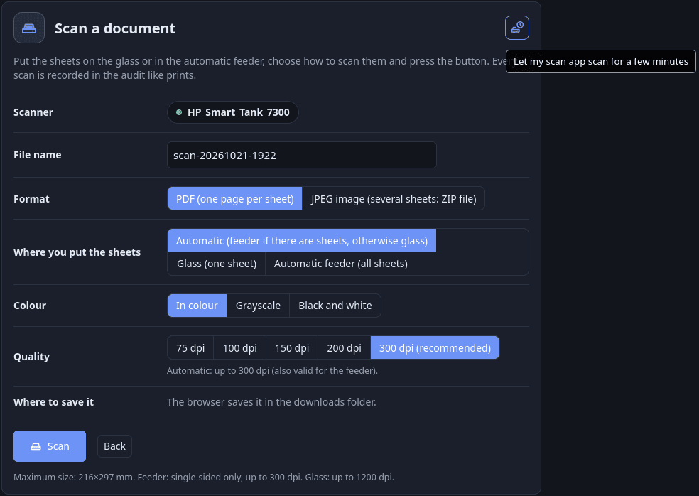

# Guida per l'utente

[Indice della documentazione](../README.md) · [English](../en/user-guide.md) · Italiano

Per chi stampa e scansiona. Tutto sta in `https://<server>:8631/me` (gli amministratori arrivano su `/admin`; il menu collega entrambe).

## 1. Accesso

Entra con l'account che ti ha dato l'amministratore (password locale), oppure con le credenziali d'ufficio se l'installazione usa RADIUS. Una password temporanea va cambiata al primo accesso.

## 2. Il mio profilo (`/me`)

- **Consumo**: job e pagine usati nella settimana o nel mese in corso, il tuo limite (quota extra compresa) e quando si azzera.
- **Documentazione**: l'icona **?** nella barra in alto apre questa guida e la guida passo passo per [Windows](windows.md).
- **Chiavi di stampa**: crea una chiave per ogni dispositivo (dagli un'etichetta). Si mostra **una volta**: copiala subito. Usala come password quando il computer o il telefono chiede le credenziali; il nome utente è il tuo. Una chiave serve solo a stampare e scansionare — non apre mai il portale e la tua password
  di dominio non serve mai su un dispositivo. Revoca una chiave (o tutte) in *Le mie chiavi* se perdi un dispositivo. Scegli per quanto tempo vale (da 1 mese a 2 anni, o una sola stampa); gli utenti RADIUS hanno un massimo più corto e la rinnovano rifacendo il login. La campanella ti dice quando un amministratore revoca, disattiva o prolunga una chiave.
- **Richieste**: chiedi più quota (temporanea o permanente), il cambio di gruppo o un permesso, e scrivi perché (facoltativo, a meno che sia richiesto). L'amministratore approva, modifica o rifiuta. Fino a 3 richieste aperte di base; puoi annullarle.
- **I tuoi permessi**: se puoi stampare a colori e solo fronte, su quali stampanti e in quali orari. Senza colore le stampe escono in bianco e nero; senza solo fronte, in fronte-retro. La scansione non cambia. Accanto a ciò che ti manca c'è il link **Chiedi** (e **Chiedi un'altra stampante**): scegli cosa ti serve,
  scrivi perché, e un amministratore risponde, per sempre o fino a una data. Finché la richiesta aspetta vedi «(richiesta in attesa)». La campanella ti dice quando è approvata, rifiutata o finita.

Se una stampa è rifiutata per la quota, il messaggio contiene il link per chiedere una deroga. Se è rifiutata per i tuoi permessi (una stampante che non puoi usare, un'ora fuori dai tuoi orari, oppure colore / solo fronte quando l'installazione rifiuta invece di correggere), il messaggio rimanda a questa pagina e la campanella ti dice cosa cambiare.
Anche una stampa uscita in bianco e nero o in fronte-retro per i tuoi permessi ha il suo avviso.

**Ogni stampa rifiutata o modificata ha il suo avviso.** Finché uno dello stesso tipo è ancora aperto viene rinnovato invece di ripetersi: l'orario si aggiorna, compare quante volte è successo (×3) e la campanella si riaccende; così un programma che riprova non riempie l'elenco.

**Avvisi secondari.** Le stampe **forzate** dai tuoi permessi (in bianco e nero, in fronte-retro) sono solo un'informazione: vengono segnate come lette da sole dopo un po' (*Impostazioni* → «Notifiche secondarie»: 20 minuti di base, contati dall'ultima stampa di questo tipo; 0 = restano finché non le chiudi). Non vengono cancellate: le trovi con *Mostra anche i chiusi*.
Tutti gli altri avvisi (stampe rifiutate, quota raggiunta, chiavi, gruppo, richieste) restano finché non li chiudi.

## 3. Stampa (`/me/print`)

Carica un PDF, una foto (JPEG, PNG, GIF) o un testo. Scegli la stampante (solo quelle che puoi usare), il formato carta, l'orientamento, colore o bianco e nero (solo se puoi stampare a colori), solo fronte o fronte-retro (solo se puoi stampare solo fronte e la stampante ha l'unità fronte-retro), un intervallo di pagine (`1,5` o `2-4`), le copie e un commento
facoltativo (50 caratteri, visibile agli amministratori accanto al nome del file). Stessa quota e stesso audit di ogni altra stampa; funziona da un telefono senza installare nulla. Per collegare un computer: [stampa.md](stampa.md).

## 4. Scansione (`/me/scan`)

Scegli lo scanner, la sorgente (automatica, vetro o caricatore per tutti i fogli), il colore, la qualità, il formato carta, il formato di uscita (PDF o JPEG) e un nome per il file. Puoi lasciare la pagina mentre scansiona e tornare a scaricare il file presto: resta 10 minuti, salvo diversa impostazione dell'amministratore, e meno se la memoria del server per le
scansioni è piena. Vedi [scansione.md](scansione.md).

Quando la scansione è finita, il file compare sotto *Le tue scansioni recenti*, con il pulsante *Scarica*:

### Scansione da un'app che non sa accedere

La maggior parte dei programmi di scansione (NAPS2 e molti altri) non sa inviare nome utente e password, quindi il gateway li rifiuta. Se in alto a destra in *Scansione* c'è il pulsante con uno scanner e un timer, puoi far entrare il tuo programma per qualche minuto:

1. Sul **computer dove gira il programma di scansione** apri *Scansione* e premi il pulsante.
2. Un riquadro mostra l'indirizzo con cui il server ti vede e un conto alla rovescia (3 minuti, salvo modifiche dell'amministratore).
3. Avvia la scansione nel programma. Le scansioni da quell'indirizzo sono accettate come tue: valgono la tua quota e i tuoi permessi e compaiono nell'audit a tuo nome. Puoi scansionare quante volte vuoi finché il tempo non finisce; una scansione già iniziata viene consegnata anche se il tempo scade. *Chiudi la finestra* la termina prima.

Una scansione da un indirizzo diverso viene rifiutata, l'audit registra i due indirizzi e la campanella lo dice. Limiti, perché il gateway può solo confrontare gli indirizzi:

- **NAT**: dietro un router condiviso con altri dispositivi (un'altra rete, VPN, Wi-Fi ospiti) il server può vedere lo stesso indirizzo per tutti, quindi durante la finestra possono scansionare anche quei dispositivi.
- **IPv4 e IPv6**: se il portale è raggiunto in IPv6 e l'app usa IPv4 (o il contrario), gli indirizzi non coincidono mai. Apri il portale con lo stesso tipo di indirizzo che usa l'app.
- **Reverse proxy**: se hai aperto il portale attraverso un proxy, l'app verrà rifiutata (o, se passa anch'essa dal proxy, qualsiasi dispositivo dietro il proxy potrebbe scansionare). Apri il portale direttamente sulla porta del server (`https://<server>:8631`) prima di premere il pulsante; il riquadro avvisa quando rileva un proxy.

Premi il pulsante sullo stesso dispositivo che scansiona (da un telefono apre la finestra per il telefono); un riavvio del server chiude tutte le finestre. Se l'indirizzo nel riquadro non è quello del tuo dispositivo, chiedi all'amministratore. Dettagli: [scansione.md](scansione.md).

## 5. Impostazioni (`/me/settings`: clic sul logo e sul nome, in alto a sinistra)

- **Tema**: chiaro, scuro o automatico. **Lingua**: English, Italiano, Español, Русский, 中文 (salvata con il tuo account).
- Intervallo di **aggiornamento automatico** dell'Audit (amministratori); ritardo delle **notifiche secondarie** (vedi sopra); **cambio password** (account locali).

## 6. Da sapere

- La quota conta i job accettati, completati e trattenuti; quelli rifiutati, falliti e annullati prima di stampare non costano nulla. Il limite pagine si controlla prima di stampare: un documento che non ci sta viene rifiutato subito.
- Le stampanti che non rispondono, sono bloccate o che non puoi usare non vengono offerte.
- Se i tuoi orari sono limitati e sei fuori orario, la pagina Stampa dice quando puoi stampare, e un lavoro inviato lo stesso viene rifiutato.
