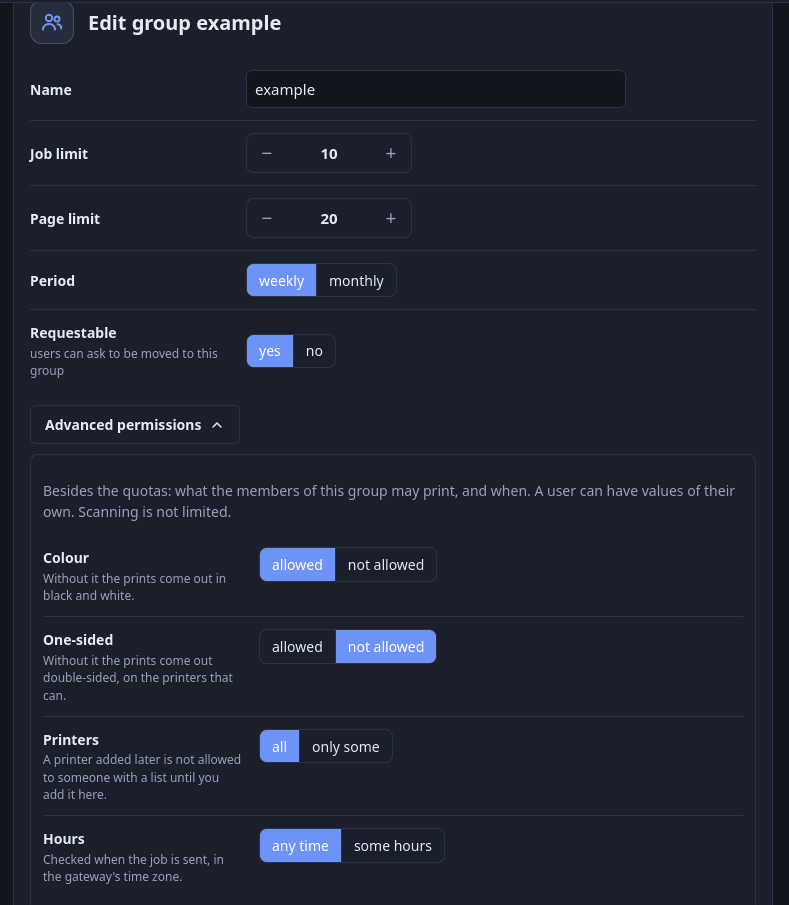

# Quote, richieste e concessioni

[Indice della documentazione](../README.md) · [English](../en/quotas.md) · Italiano

## 1. Limiti

Una **regola** dice: *questo utente o gruppo può stampare al massimo N **job** (o **pagine**) per **settimana** (o **mese**)*.

- Le regole appartengono a un gruppo, con **override per utente** facoltativi: una regola utente sostituisce quella del gruppo per la stessa metrica.
- Periodi: **settimanale** (lunedì–domenica) o **mensile** (mese di calendario), in `SPOOLSTEWARD_TIMEZONE`, ora legale compresa. Nessuna regola = nessun limite.
- Dove si impostano: *Gruppi* → modifica, *Utenti* → modifica, oppure la CLI: `spoolsteward-admin group-limit staff 20 --period monthly`,
  `spoolsteward-admin user-limit mario 5 --metric pages` (`none` toglie un limite).

### Cosa conta

Contano i job `accepted`, `completed` o `held`. **I job rifiutati, falliti e annullati prima della stampa non consumano quota.** L'utente vede consumo e prossimo azzeramento in *Profilo*.

### Pagine contate prima di stampare

Con un limite di pagine, il gateway legge il documento **prima** di stamparlo (fino a 64 MB) e ne conta le pagine: PDF, JPEG/PNG/GIF = 1, URF dall'intestazione, PostScript
da `%%Pages`, testo semplice ≈ 60 righe per pagina; per le copie e l'intervallo di pagine. Se `usate + pagine > limite` il job è **rifiutato subito**:

> `would be exceeded (used 90, this document 200, limit 100)`

Altrimenti le pagine sono registrate al momento, così i job simultanei le vedono (controllo e registrazione sono un unico passaggio sotto lock, concessioni attive comprese).
Dopo la stampa il riconciliatore sostituisce la stima con le **pagine reali** lette da CUPS. Per i file di cui non si possono contare le pagine il limite è morbido: [limiti.md](limiti.md#2-quota).

## 2. Richieste degli utenti

In *Profilo* un utente può chiedere:

1. **Più quota** — metrica, quantità, **temporanea** o **permanente**, e un motivo. Solo le metriche che hanno un limite. Il **periodo è quello della regola**, mostrato in sola lettura ("il tuo limite pagine è mensile: la deroga durerà fino al 1 novembre").
2. **Cambio di gruppo** — solo verso gruppi marcati *richiedibili*.
3. **Un permesso** — colore, solo fronte, una stampante in più o stampare fuori orario ([Chiedere un permesso](#chiedere-un-permesso)).

Al massimo `SPOOLSTEWARD_MAX_OPEN_REQUESTS` (3) richieste aperte per utente; il motivo è facoltativo a meno che `SPOOLSTEWARD_REQUEST_REASON_REQUIRED=true`; le richieste scadono dopo
`SPOOLSTEWARD_REQUEST_TTL_DAYS` (14). L'utente può annullare una richiesta in attesa.

## 3. Approvazione e concessioni

Gli amministratori vedono le richieste in attesa in **Richieste** (contatore nel menu) e le **approvano, modificano o rifiutano**; possono cambiare quantità e tipo (anche rendere
temporanea una permanente) e aggiungere una nota. L'approvazione produce una **concessione** che si **somma** al limite: `limite effettivo = regola + concessioni attive`.

- Una concessione **temporanea** vale fino alla fine della finestra del periodo **in cui avviene l'approvazione** (una richiesta fatta domenica sera e approvata lunedì non deve nascere già scaduta).
- Una concessione **permanente** si applica a ogni periodo successivo finché non viene revocata.
- Il cambio di gruppo sposta subito l'utente. Un'approvazione ripetuta concede una volta sola. `job_log` non viene mai modificato.

Gli amministratori possono anche concedere o revocare quota direttamente in **Richieste**; tutto finisce nel registro degli amministratori ([audit.md](audit.md)). L'elenco utenti mostra le concessioni attive come `+N` colorato.

## 4. Motivi mostrati agli utenti

Un job rifiutato dà al client IPP il motivo in inglese più l'indirizzo del portale per chiedere una deroga. Il portale mostra la stessa frase tradotta ([lingue.md](lingue.md));
l'audit conserva quella inglese.

## 5. Permessi avanzati

Le quote dicono *quanto*; i permessi dicono *cosa*, *dove* e *quando*. Si impostano con il pulsante **Permessi avanzati** in fondo alla pagina del gruppo (*Gruppi* → modifica) e dell'utente (*Utenti* → modifica); il blocco è chiuso quando tutto è al valore predefinito.

| Permesso | Se non è concesso |
|---|---|
| **Colore** | Le stampe escono in bianco e nero. |
| **Solo fronte** | Le stampe escono in fronte-retro (lato lungo), sulle stampanti con unità fronte-retro. |
| **Stampanti** | Si possono usare solo le stampanti dell'elenco. Predefinito: tutte. |
| **Orari** | Si stampa solo nei giorni scelti, tra le due ore. Predefinito: sempre. |

Di predefinito è tutto consentito. Ogni permesso è una riga di pulsanti (*consentito* / *non consentito*, *tutte* / *solo alcune*, *sempre* / *solo in certi orari*); stampanti, giorni e ore compaiono solo dopo la
seconda scelta. Nella pagina di un utente ogni riga comincia con *come il gruppo (…)*.

**Gruppo e utente.** Il gruppo dà i valori; ogni campo di un utente è "come il gruppo" (predefinito) oppure ha un valore proprio, campo per campo. Se cambi i permessi del gruppo cambiano per chi lo segue
senza avviso; se cambi quelli propri di un utente, a lui arriva un avviso. Un amministratore è limitato come tutti, tranne l'**amministratore di emergenza**
(`SPOOLSTEWARD_BOOTSTRAP_ADMIN_USERNAME`, account locale): ha tutti i permessi (nella sua pagina il blocco è spento e il server ignora ciò che viene inviato per lui), nessun gruppo, nessuna quota, e non può chiedere di cambiare gruppo.
**La scansione non è limitata** da niente di tutto questo.

### Stampanti

L'elenco contiene nomi di coda in minuscolo. Una stampante aggiunta **dopo** che l'elenco è stato fatto **non** è consentita finché non la spunti. Se una coda viene **rinominata** ([stampanti.md](stampanti.md)), il suo nome cambia da solo in tutti gli elenchi.
Se una coda viene **tolta**, il suo nome resta negli elenchi ("non presente"), così una stampante sostitutiva a cui si dà quel nome ritrova i permessi.

### Orari

Una sola fascia: i giorni della settimana e due ore (`HH:MM`) in `SPOOLSTEWARD_TIMEZONE`. L'ora di fine non è inclusa: da `08:00` a `17:00` passa un lavoro inviato alle 16:59, non alle 17:00. Se la fine è prima dell'inizio (da `22:00` a `06:00`)
la fascia passa la mezzanotte e appartiene al giorno in cui comincia. Inizio e fine non possono essere uguali. Gli orari si controllano **quando il lavoro viene inviato**: un lavoro già accettato non viene fermato quando la fascia si chiude.

### Cosa succede a un lavoro

Il gateway controlla in quest'ordine: stampante bloccata o manutenzione, poi i permessi, poi la quota.

| Cosa ha chiesto il client | Non consentito | Risultato |
|---|---|---|
| Una stampante fuori dall'elenco | | **Rifiutato**, sempre |
| Un'ora fuori dalla fascia | | **Rifiutato**, sempre |
| Colore non indicato (niente, o `auto`) | niente colore | Stampato in bianco e nero. Nessun avviso |
| Colore indicato (`color`) | niente colore | `SPOOLSTEWARD_PERMISSION_MODE=adjust` (predefinito): bianco e nero, all'utente arriva un avviso. `refuse`: rifiutato |
| Lati non indicati | niente solo fronte | Stampato in fronte-retro (lato lungo). Nessun avviso |
| `one-sided` indicato | niente solo fronte | `adjust`: fronte-retro, avviso. `refuse`: rifiutato |

Le regole guardano `print-color-mode`, `sides` e le opzioni che alcuni driver mandano con i nomi del PPD (`ColorModel`, `ColorMode`, `Duplex`). Una stampante senza colore non viene mai toccata dalla regola sul colore; una senza
unità fronte-retro stampa solo fronte e non viene rifiutata. Il gateway chiede alla coda cosa sa fare (ricordato un minuto); se CUPS non risponde si corregge solo ciò che il client ha indicato in modo esplicito.

Un lavoro rifiutato finisce nell'audit come `denied` con il motivo, **non consuma quota né pagine**, e all'utente arriva un avviso (ogni rifiuto rinnova quello aperto con un contatore). Il client IPP riceve il motivo e l'indirizzo della
pagina del profilo, dove l'utente vede i suoi permessi e può chiedere quello che manca.

### Da leggere prima di scegliere la modalità

1. **Windows e Android spesso mandano `sides=one-sided` o il colore in ogni lavoro**, anche se la persona non ha toccato l'opzione. Con `refuse` molti loro lavori vengono rifiutati finché non cambiano l'opzione nella finestra di stampa.
   Per questo il predefinito è `adjust`.
2. **Il bianco e nero forzato può non funzionare** con alcune stampanti e driver, soprattutto con immagini che il telefono ha già trasformato in pixel a colori (iPhone / AirPrint): il gateway chiede, la stampante decide. Per una garanzia usa
   `refuse`. Il fronte-retro usa l'attributo standard `sides` ed è più affidabile, purché la coda dichiari l'unità fronte-retro.
3. **L'annuncio mDNS è uguale per tutti**: le stampanti che una persona non può usare si **vedono** comunque e un lavoro mandato lì viene rifiutato. L'elenco che il gateway dà dopo l'accesso le lascia fuori.
4. Gli orari si controllano all'invio; la scansione non è limitata; l'amministratore di emergenza è esente da permessi e quote.

### Cosa vede l'utente

- *Profilo*: il riquadro "I tuoi permessi" con il link per chiedere quello che manca. Gli elenchi di stampanti e gli indirizzi pronti mostrano solo le stampanti che la persona può usare.
- *Stampa*: solo le stampanti consentite; niente scelta del colore senza il permesso; una scelta fronte-retro sulle stampanti duplex solo per chi può stampare solo fronte; un avviso con gli orari consentiti quando è fuori orario.
- La campanella: avvisi "rifiutato", "quota raggiunta" e "modificato" (quello "modificato" è *secondario*: si legge da solo dopo il tempo scelto in `/me/settings`, 20 minuti di base), e uno quando un amministratore cambia i permessi propri della persona.

Il registro degli amministratori (*Azioni*) annota ogni modifica ai permessi con i valori vecchi e nuovi.

### Chiedere un permesso

Chi non ha un permesso lo chiede nel riquadro "I tuoi permessi" del profilo: **Chiedi** accanto a colore, solo fronte e orari, **Chiedi un'altra stampante** per le stampanti. Il modulo offre solo ciò che la persona non ha, e solo le stampanti
che esistono adesso. Il motivo è obbligatorio solo con `SPOOLSTEWARD_REQUEST_REASON_REQUIRED=true` (al massimo 500 caratteri). La richiesta viene rifiutata se la persona ha già quel permesso o ha già chiesto la stessa cosa senza risposta.
Valgono gli stessi freni delle richieste di quota (`SPOOLSTEWARD_MAX_OPEN_REQUESTS` per tutti i tipi insieme, `SPOOLSTEWARD_REQUEST_TTL_DAYS`).

L'amministratore la vede in **Richieste** e sceglie **permanente** oppure **fino alla fine del** giorno scelto (vale per tutto il giorno in `SPOOLSTEWARD_TIMEZONE`, oggi o dopo). Approvare crea una *concessione di permesso* che
**allarga** ciò che danno il gruppo e la regola della persona e non toglie mai nulla:

| Richiesto | La concessione dà |
|---|---|
| Colore | il colore è permesso |
| Solo fronte | la stampa solo fronte è permessa |
| Una stampante | quella stampante entra nell'elenco della persona (senza elenco tutte sono già permesse) |
| Fuori orario | la fascia oraria non si applica |

Un'approvazione ripetuta concede una volta sola; un'approvazione rifiutata (per esempio una data passata) lascia la richiesta in attesa. Le concessioni di permesso attive stanno nello stesso elenco *Concessioni attive* di quelle di quota, con *Revoca*;
quelle finite vanno nello storico e *Elimina le concessioni scadute* toglie entrambi i tipi. La pagina di modifica dell'utente elenca le sue concessioni di permesso attive. Il registro degli amministratori annota approvazioni, concessioni dirette, revoche ed eliminazioni.

Un amministratore può anche concedere un permesso senza richiesta (*Concedi senza richiesta* → **un permesso**). Scelto l'utente, il modulo propone solo ciò che non ha già; il server rifiuta comunque ciò che ha. Senza JavaScript il modulo
mostra tutti i campi e il server legge solo quelli del tipo scelto.

La campanella dice alla persona quando la richiesta è approvata (con la data di fine) o rifiutata, quando un amministratore concede o revoca un permesso, e, entro l'ora dopo la data di fine, che un permesso temporaneo è finito. Un amministratore non riceve avvisi per ciò che fa al proprio account.
