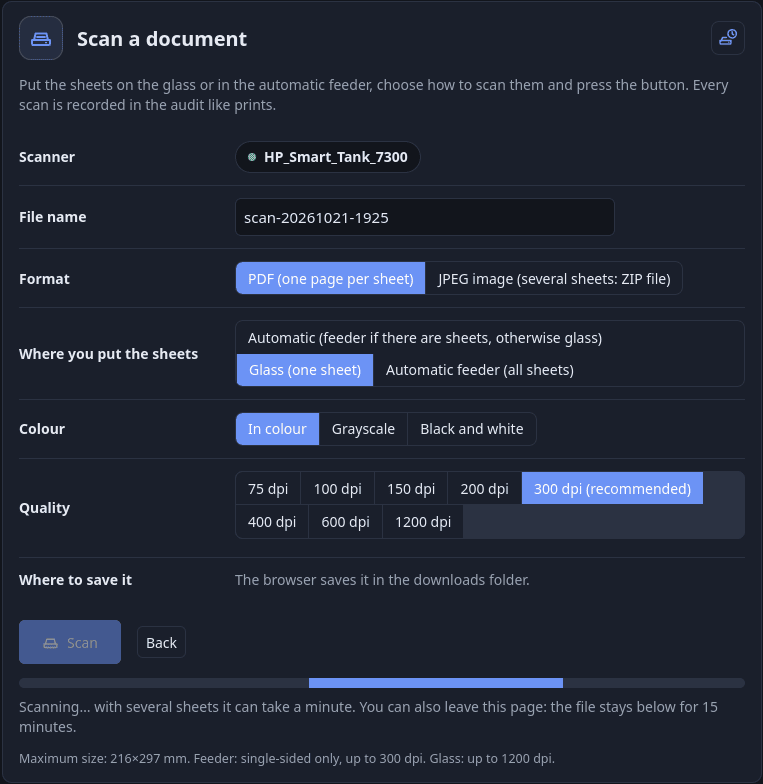

# Scansione

[Indice della documentazione](../README.md) · [English](../en/scanning.md) · Italiano

La scansione usa **eSCL** (AirScan): `ipp-usb` lo serve sulla stessa porta di IPP, quindi stampa e scansione passano dallo stesso
dispositivo USB senza litigare — **ipp-usb è l'unico proprietario** (`ipp-usb` e SANE dell'host vanno fermati). Una stampa inviata durante
una scansione funziona. SANE in rete è stato scartato: non autentica per utente e riporterebbe il conflitto sul dispositivo; TWAIN Direct
è poco supportato.

## 1. Scoperta degli scanner

Gli scanner non si configurano uno per uno; si **trovano a runtime**:

- a ogni coda CUPS di rete (ipp-usb dà a ogni stampante USB la sua porta) si chiedono le capacità eSCL;
- più gli indirizzi elencati in `SPOOLSTEWARD_SCAN_URL` (`nome=url`, separati da virgola; l'immagine preimposta `http://ipp-usb:60000`; `none` =
  solo scoperta automatica).

Gli scanner rispondono a eSCL sulla porta IPP della coda o sulla 80; gli altri casi vanno in `SPOOLSTEWARD_SCAN_URL`. Uno scanner scollegato
sparisce entro ~30 s. Il servizio `mdns` annuncia ogni scanner come `_uscans._tcp` (`rs` = `eSCL` per quello predefinito, `eSCL-<id>` per gli altri).

## 2. Scansionare dal portale

*Scansiona* (`/me/scan`): nulla da installare, funziona da qualunque telefono.

- Scelta dello **scanner** se ce n'è più di uno.
- **Sorgente**: *Automatica* (caricatore se lo scanner dichiara `ScannerAdfLoaded`, altrimenti vetro), *Vetro* o *Caricatore* (legge **tutti** i
  fogli fino a quando `NextDocument` risponde 404; massimo 100).
- Colore / grigi / bianco e nero; **qualità** e **formato carta** secondo ciò che lo scanner dichiara davvero per quella sorgente (per
  esempio vetro fino a 1200 dpi e caricatore solo fronte fino a 300).
- Uscita: **PDF** (più fogli uniti con pypdf) o **JPEG** (più fogli: ZIP); campo **nome del file**.
- Dove salvare: i browser Chromium aprono la scelta della cartella (File System Access API); gli altri salvano nella cartella dei
  download (un sito web non può scrivere in un percorso digitato a mano).
- La scansione gira come **attività di fondo del server**: puoi lasciare la pagina e scaricare dopo (il risultato resta **10 minuti in
  memoria**, visibile solo al proprietario; una scansione web alla volta). Se lo scanner risponde 409/503 (si sta svegliando) il
  gateway riprova 3 volte.
- Le scansioni finite aspettano **nella memoria del server** (una pagina a colori a 300 dpi pesa circa 1 MB; un caricatore da 100 pagine
  può arrivare a 100 MB). Tre impostazioni in `.env` la tengono sotto controllo: `SPOOLSTEWARD_SCAN_KEEP_MINUTES` (predefinito 10) è
  quanto resta una scansione finita; `SPOOLSTEWARD_SCAN_KEEP_MB` (predefinito 50) è quanto possono tenere tutte le persone insieme:
  quando una nuova scansione non ci sta, **le più vecchie già finite vengono tolte per prime** (la più recente resta sempre, anche se da
  sola è più grande); e `SPOOLSTEWARD_SCAN_DELETE_AFTER_DOWNLOAD` (predefinito `false`): con `true` una scansione esce dalla memoria e
  dalla pagina appena il suo download è finito, quindi si scarica una volta sola. Una scansione tolta va rifatta: scaricala presto.

## 3. Scansione con client eSCL

Il gateway espone `/eSCL/...`. `ScannerCapabilities` e `ScannerStatus` sono pubblici (come la query di capacità IPP); tutto il resto
richiede HTTP Basic con **nome utente + chiave di stampa**, stessa autenticazione e stesso throttling della stampa. Percorsi ammessi:
`ScanJobs` (POST), `ScanJobs/<id>/NextDocument|ScanImageInfo` (GET), `ScanJobs/<id>` (DELETE); il resto è 404.

- Ogni scansione è una riga dell'audit con `kind=scan`; il dispositivo è la coda CUPS dello scanner. Stati: `accepted` → `completed`
  (1 pagina per `NextDocument`), `failed` (scanner occupato o che non risponde), `canceled` (solo se annullata prima di consegnare la pagina).
- Un utente non può leggere né annullare la scansione di un altro (404). `Location` è riscritto sull'indirizzo del gateway.
- Il job eSCL resta associato all'utente finché il client lo cancella con DELETE — è questo che libera lo scanner.
- **Client senza credenziali** (NAPS2 non sa inviarle): `SPOOLSTEWARD_ESCL_ANONYMOUS=true` accetta scansioni senza login, registrate come
  l'account locale senza password `unknown-guest` (non può entrare nel portale; il nome è `SPOOLSTEWARD_ESCL_GUEST_USERNAME`), con l'IP di chi chiama nelle opzioni dell'audit.
  Credenziali sbagliate restano 401. Finché l'opzione è spenta, una richiesta senza credenziali viene rifiutata (401) e compare come avviso nella campanella ([guida-amministratore.md](guida-amministratore.md)), al massimo una volta per intervallo e per fonte. **Predefinito spento**; chiunque nella rete raggiunga la porta 8631 potrebbe scansionare: usalo solo su
  rete fidata. NAPS2 non ha trovato l'annuncio mDNS: inserisci IP e porta a mano.
### Finestra di scansione

**Finestra di scansione** (`SPOOLSTEWARD_ESCL_WINDOW`, accesa di default; è un ultimo rimedio, vedi i limiti più sotto): un pulsante in alto a destra in *Scansione* (uno scanner con un
timer) dice al gateway «la mia app sta per scansionare». Il gateway si segna l'indirizzo che vede per quella connessione e, per
`SPOOLSTEWARD_ESCL_WINDOW_SECONDS` (60–900, predefinito 180), accetta richieste **senza credenziali solo da quell'indirizzo**, a nome di
chi ha premuto il pulsante: valgono la sua quota e i suoi permessi e l'audit riporta il suo nome e l'indirizzo. Finché la finestra
è aperta si possono fare quante scansioni si vuole. La finestra decide solo se può partire una scansione **nuova**: una scansione
già iniziata viene consegnata, e può essere chiusa con DELETE, anche se nel frattempo la finestra scade o viene chiusa (il job
resta legato all'indirizzo che l'ha avviato). Non gira nulla in background: una finestra scaduta è solo un orario passato. Le
finestre stanno in memoria, quindi un riavvio le chiude. Una persona ha una sola finestra; se due persone premono dallo stesso
indirizzo vale l'ultima pressione.
Con `SPOOLSTEWARD_ESCL_ANONYMOUS=true` la finestra cambia solo a chi va la scansione: alla persona, invece che a `unknown-guest`. Con
`SPOOLSTEWARD_ESCL_WINDOW=false` pulsante, script e testi non sono proprio nella pagina.
Quando una richiesta senza credenziali arriva da un altro indirizzo mentre c'è una finestra aperta, viene rifiutata (401). L'audit
riceve una riga *negata* per il proprietario della finestra con i due indirizzi (l'icona informazioni li mostra) e la sua
campanella dice «scansione rifiutata: la finestra era per X, la richiesta arriva da Y». La stessa coppia è registrata al massimo
una volta al minuto, così un programma che riprova di continuo non riempie l'audit.

### Limiti della finestra di scansione

La finestra di scansione è un **ultimo rimedio**, per le app che non sanno inviare né nome utente né chiave e quando vuoi comunque ogni
scansione nell'audit. Si regge su una cosa debole: l'indirizzo della connessione TCP. Tutto ciò che cambia quell'indirizzo rompe il metodo:

- **NAT**: se il browser e l'app di scansione stanno dietro lo stesso router, per il server (per esempio un'altra rete, una VPN o il
  Wi-Fi ospiti), il server vede l'indirizzo del router per *entrambi*. La finestra accetta allora anche ogni altro dispositivo dietro
  quell'indirizzo, finché è aperta. Se i due stanno su reti diverse con NAT diversi, gli indirizzi differiscono e la scansione è
  rifiutata.
- **IPv4 e IPv6 insieme**: un computer può raggiungere il portale in IPv6 e l'app di scansione collegarsi in IPv4 (o il contrario). I due
  indirizzi sono diversi e non coincidono. Apri il portale con l'indirizzo della stessa famiglia usata dall'app (il riquadro che si
  apre premendo il pulsante dice quale indirizzo ha visto il server). Un indirizzo IPv4 scritto in forma IPv6 (`::ffff:192.168.1.5`) è
  trattato come quello IPv4.
- **Reverse proxy** (Nginx Proxy Manager e simili). Se apri il portale *attraverso* il proxy, il server vede l'indirizzo del proxy e non
  quello del tuo computer, e la finestra si apre per l'indirizzo del proxy. L'app di scansione di norma si collega direttamente alla
  porta 8631 con il proprio indirizzo, quindi i due non coincidono mai e la scansione è rifiutata. Il caso inverso è peggiore: se
  anche l'app di scansione passa dal proxy, tutti i dispositivi che raggiungono il server tramite il proxy hanno lo stesso indirizzo,
  quindi durante la finestra *qualsiasi* di loro può scansionare. Il server si fida di `X-Forwarded-For` solo da `127.0.0.1` e dagli indirizzi in `FORWARDED_ALLOW_IPS` ([certificati.md](certificati.md#41-dietro-un-reverse-proxy)), perciò
  un proxy su un'altra macchina non aiuta se non è elencato lì. Quello che funziona: premi il pulsante da una pagina aperta **direttamente** sul gateway
  (`https://<server>:8631/me/scan`, non attraverso il proxy). Il riquadro avvisa quando la richiesta portava intestazioni di proxy.
- **Un altro dispositivo**: il pulsante va premuto dal computer su cui gira l'app di scansione. Premerlo da un telefono apre la
  finestra per il telefono.
- **Indirizzo che cambia**: DHCP o roaming Wi-Fi durante la finestra interrompono la corrispondenza.

Se l'indirizzo nel riquadro non è quello del dispositivo che scansiona, la finestra non può funzionare su quella rete: usa
`SPOOLSTEWARD_ESCL_ANONYMOUS=true` su una rete fidata, oppure un'app di scansione che sa inviare nome utente e chiave di stampa. La guida
utente riporta gli stessi limiti in forma breve per chi preme il pulsante.

## 4. Note

- Una scansione consegnata sul client conta come completata anche se l'utente non salva il file.
- Se il caricatore dorme lo scanner può dichiararlo vuoto: in *Automatica* si finisce sul vetro (pagina bianca). Scegli *Caricatore*
  oppure togli e rimetti i fogli.
- La modalità manutenzione ferma anche la scansione ([stampanti.md](stampanti.md)).
- Non ancora provati: client eSCL nativi che sanno autenticarsi (sane-airscan, Image Capture).
